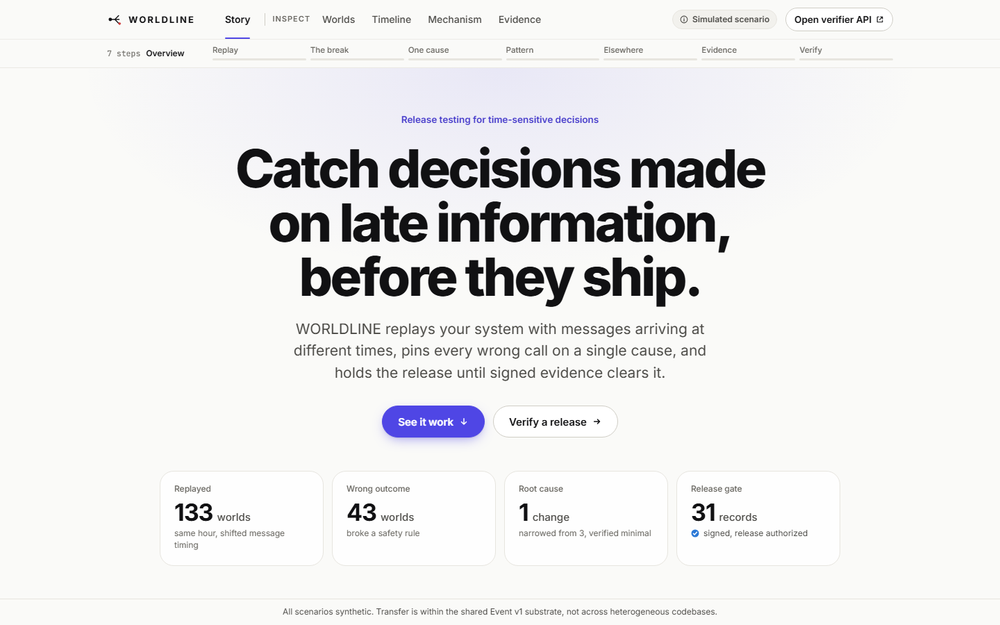
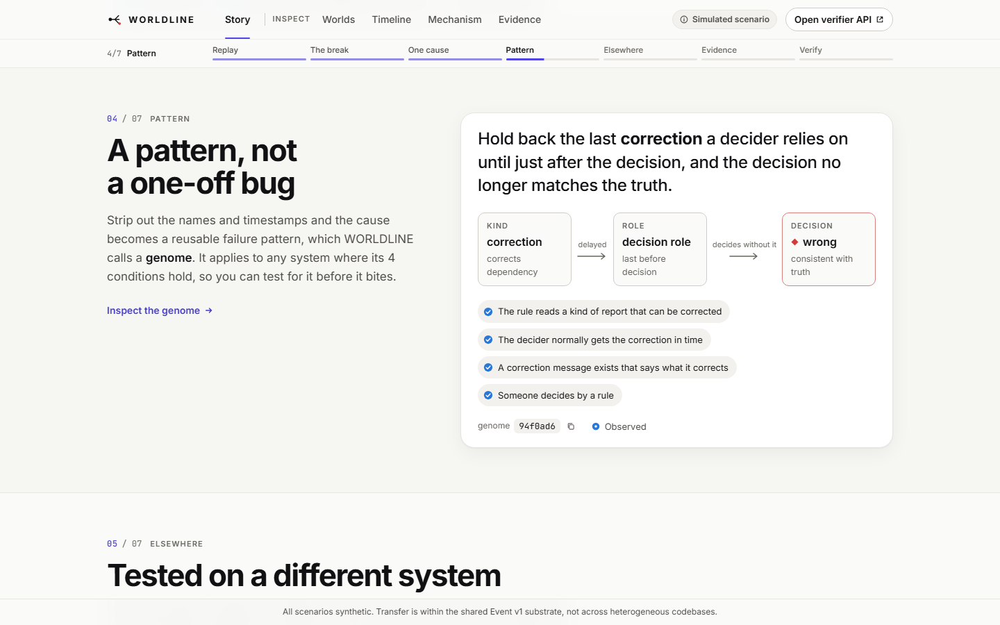
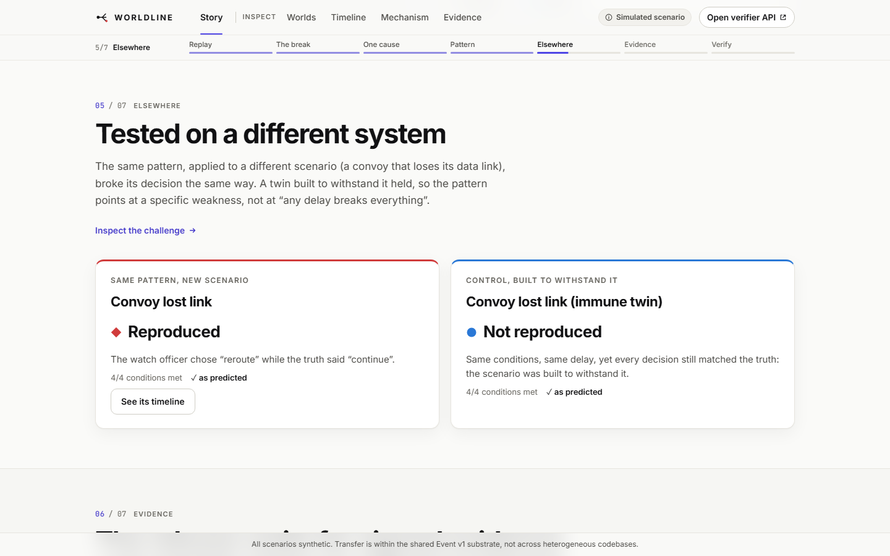
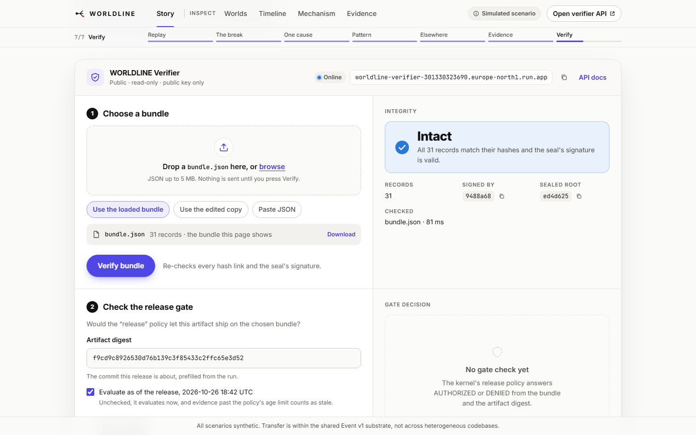
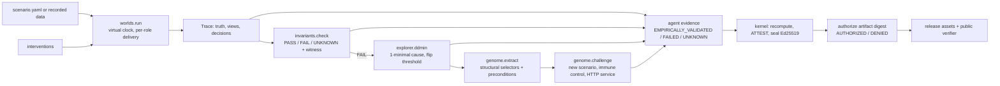

# WORLDLINE

**Catch decisions made on late information before they ship. WORLDLINE replays a system in hundreds of alternative worlds, isolates the single change that breaks a guarantee, carries that failure mechanism to systems it has never seen, and refuses to release until independently recomputed, signed evidence clears the exact commit.**

[](https://gitlab.com/shafir2/WorldLine/-/pipelines)
[](https://gitlab.com/shafir2/WorldLine/-/releases)
[](https://worldline-verifier-301330323690.europe-north1.run.app)
[](https://worldline-3e380d.gitlab.io/docs/)


[](LICENSE)

Live product: **https://worldline-verifier-301330323690.europe-north1.run.app**. Source on [GitLab](https://gitlab.com/shafir2/WorldLine) (primary, CI and agents) and mirrored on [GitHub](https://github.com/shafir-01/WorldLine).



## Contents

[The problem nobody tests for](#the-problem-nobody-tests-for) · [What WORLDLINE does](#what-worldline-does) · [Results](#results) · [Where the mechanism transfers](#where-the-mechanism-transfers) · [What we deliberately did not add](#what-we-deliberately-did-not-add) · [Install](#install) · [Usage](#usage) · [Architecture](#architecture) · [GitLab agents and the kernel](#gitlab-agents-and-the-kernel) · [Releases and verification](#releases-and-verification) · [Project structure](#project-structure) · [Testing](#testing) · [Evidence kinds](#evidence-kinds) · [What we do not have yet](#what-we-do-not-have-yet) · [Contributing](#contributing) · [License](#license) · [Author](#author)

## The problem nobody tests for

A change is judged against one world, the one where every message arrived on time. Tests pass, the pipeline is green, an agent writes a confident explanation, and the system still makes the wrong call when the one message that mattered lands ninety seconds late. Operations centres, dispatch rooms, triage boards, approval services and alerting systems all share this failure, and none of them have a test for it, because the bug is not in the logic. It is in what the decider knew at the moment of deciding.

WORLDLINE is the first pipeline stage built for exactly that question. It separates what happened from what each role had received, replays the system with message timing perturbed, finds the worlds where a decision diverges from what the same rule says over the truth, reduces each to one cause, and converts that cause into a mechanism that can be tested against other systems.

## What WORLDLINE does


**Replays one history as hundreds of worlds.** A deterministic virtual clock, a forkable seeded random stream and hash-chained logs make every world reproducible to the byte. Interventions are injected at the delivery layer, never in the model: delay, drop, duplicate, reorder, corrupt, revoke, clock skew. Guided search reads only the declared decision rules and finds decision failures an order of magnitude sooner than random search at the same budget.


**Keeps three information states apart.** Simulated truth, each role's received observations with their receipt times, and evaluator conclusions live in separate stores with separate clocks. A role can only ever know what it has received. The invariant `decision.consistent_with_truth` fires when a rule-based decision differs from what the same rule says over the truth, and the fault-attributed witness names exactly the late information that caused it.



**Reduces every failure to one cause, then abstracts it.** Delta debugging shrinks a failing schedule to a 1-minimal set and independently re-checks minimality. For single delays the exact flip threshold is solved analytically rather than swept. The cause is then abstracted into a FailureGenome with structural selectors and preconditions and no event ids at all.



**Carries the mechanism to systems it has never seen.** A genome is instantiated against a new scenario by structure, run, and judged: reproduced, not reproduced, or preconditions unmet. A deliberately immune variant is the negative control and must not reproduce.


**Types every claim and gates the release.** PROVED_WITHIN_MODEL, EMPIRICALLY_VALIDATED, ATTESTED, FAILED or UNKNOWN. Evidence is hash-chained and Ed25519-sealed. Agents can never emit ATTESTED. The kernel recomputes what agents report, turns any mismatch into a FAILED integrity record, binds authorization to the exact artifact digest, and revokes it when an assumption is invalidated or evidence goes stale.



**Lets anyone verify a release with nothing but the public key.** The public verifier on Cloud Run serves the viewer and the kernel's API. Drop a bundle, get the tamper findings down to the record. Check a release tag and get the authorization decision for its commit.

## Results

Measured by the code in this repository, on one machine, recorded in `experiments/out/`. Regenerate with `uv run worldline demo --budget 150 --seed 42` and `uv run python experiments/benchmark.py --seeds 5 --budget 150`.

| What | Result |
|---|---|
| Worlds explored on the port scenario, seed 42 | 133; 43 broke a declared rule |
| Guided search vs random, failing worlds per 100 branches, mean of 5 seeds | 44.5 vs 30.5 |
| First branch with a wrong decision, mean of 5 seeds | guided 3.4, windowed 1.0, random 14.0 |
| Minimization, 5 failing schedules of size 3 to 4 | all reduced to 1 intervention, 1-minimality verified, 3.4 oracle calls on average |
| Exact flip threshold for the delayed correction | 90.218 s, confirmed one nanosecond either side |
| Equivalence reduction at budget 150 | 16 to 28 percent fewer runs, identical failing-set coverage, zero soundness violations |
| Kernel on the release commit | 31 records, 16 attested by recomputation, 0 agent-report mismatches, AUTHORIZED 5 of 5 |
| One edited record in the bundle | DENIED, `integrity:record_edited@1` |
| Test suites | 342 Python, 42 browser end-to-end, zero accessibility violations at any impact level |

## Where the mechanism transfers

The genome extracted from the port scenario, instantiated by structure and never by id, against targets built without reference to it:

| Target | Domain | Truth stream | Outcome |
|---|---|---|---|
| `convoy_lostlink` | logistics convoy with a drone scout | simulated | **reproduced** |
| `convoy_lostlink_immune` | same system, rule requires two reports | simulated | preconditions met, **not reproduced** |
| `triage_board` | hospital emergency department | simulated | **reproduced** |
| `real/usgs_20250729…` | earthquake advisories | **recorded USGS events of the 2025 Kamchatka M8.8 sequence, real timestamps, real magnitude revisions as corrections** | **reproduced**, and the genome extracted from the real data reproduces back on the port scenario |
| `examples/service_demo` | approvals API | simulated truth, **driven request by request through a real FastAPI service over HTTP** | **reproduced** against real request handling; service agreed with the simulator on all 85 worlds |

Transfer holds across every domain we have pointed it at so far, within one event substrate. The real-data scenario keeps its roles, latencies and decision rule as declared models and says so in its header and in [docs/REAL_DATA.md](docs/REAL_DATA.md). The HTTP run is described in [docs/REAL_SERVICE.md](docs/REAL_SERVICE.md).

## What we deliberately did not add

These are design decisions, not gaps. Each one exists to keep the results defensible.

- **No language model anywhere in the simulated world, the checker, the minimizer or the kernel.** Agents investigate and propose; a deterministic kernel decides. Every verdict is reproducible from a seed.
- **No self-certification.** An agent cannot produce an ATTESTED record. The kernel recomputes each claim before attesting it, and a mismatch denies the release.
- **No hand-typed numbers.** Every figure in this file is read from JSON written by code that ran, and the benchmark file carries the definitions of each metric.
- **No simulated data presented as real.** Recorded data is labelled with its source URL, fetch time, hash and licence. Modelled parts are labelled as models in the same file.
- **No hidden randomness.** All randomness flows through one forkable seeded stream. Schedules that violate the time rule are recorded as rejected, never silently dropped.
- **No mocked verification.** The verifier on Cloud Run holds only the public key and recomputes against the committed policy. The release endpoint fetches the bundle from the package registry and checks it live.
- **No unprotected kernel.** Invariants, policy, the evidence module and the kernel CI jobs are CODEOWNERS-protected, the signing key is a protected CI variable, and kernel jobs soft-fail on unprivileged merge-request pipelines instead of leaking it.
- **No vacuous repairs.** The repair contract requires that the non-default decision remain reachable and that the specimen still fails, so a "fix" that disables a rule cannot pass.

## Install

```bash
uv tool install --index https://gitlab.com/api/v4/projects/88121109/packages/pypi/simple worldline
worldline --version
worldline resources      # bundled scenarios, invariants, policy and public key
worldline demo           # explore, minimize, genome, challenge, verify, authorize, then a denied tampered bundle
```

From source:

```bash
git clone https://gitlab.com/shafir2/WorldLine.git && cd WorldLine
uv sync --extra dev --extra service
uv run pytest -q
uv run worldline demo --out experiments/out --budget 150 --seed 42
cd ui && npm ci && npm run build && npm run preview
```

Other options, including the CLI container image, are in [docs/INSTALL.md](docs/INSTALL.md).

## Usage

```bash
# author and validate a scenario (JSON Schema, path and line errors, did-you-mean)
worldline init scenarios/my_system.yaml
worldline validate scenarios/my_system.yaml

# explore, minimize, abstract, challenge
worldline explore scenarios/port_alert.yaml --budget 200 --seed 42 --out experiments/out --strategy both
worldline minimize experiments/out/exploration.json --out experiments/out
worldline genome extract experiments/out/minimal_schedule.json --out experiments/out/genome.json
worldline genome challenge experiments/out/genome.json scenarios/triage_board.yaml --seed 42 --out experiments/out/challenge.json

# real inputs
worldline real usgs --start 2025-07-29T23:20:00Z --end 2025-07-30T01:40:00Z --minmag 5.5 --offline
worldline http demo --budget 60 --seed 42 --out experiments/out_http

# the kernel
worldline report experiments/out --code-commit $(git rev-parse HEAD)
worldline verify experiments/out --signing-key policies/kernel_private.pem --public-key policies/kernel_public.pem --out experiments/out/bundle.json
worldline authorize experiments/out/bundle.json --policy policies/release.yaml --public-key policies/kernel_public.pem --artifact-digest $(git rev-parse HEAD) --out experiments/out/authorization.json
```

The scenario grammar, the predicate DSL and a ten-step tutorial are in [docs/AUTHORING.md](docs/AUTHORING.md). The twelve declared invariants are in [docs/INVARIANTS.md](docs/INVARIANTS.md). Exploration strategies, equivalence reduction and thresholds are in [docs/EXPLORER.md](docs/EXPLORER.md).

## Architecture



Everything left of the kernel may be produced by agents. The kernel reads only the committed public key, the policy and the bundle, recomputes verdicts from traces, and is the sole producer of ATTESTED records. Module contracts are in [docs/ARCHITECTURE.md](docs/ARCHITECTURE.md); the thesis and prior art in [docs/THESIS.md](docs/THESIS.md); measurements in [docs/REPORT.md](docs/REPORT.md).

## GitLab agents and the kernel

Three custom Duo agents and three flows ship as text in [docs/duo/](docs/duo/) and are created in the project's AI catalog by `scripts/duo_setup.py`.

| Agent | Trigger | Role |
|---|---|---|
| Investigator | work item, mention | Re-runs the exploration on a GitLab-hosted runner, checks determinism, minimizes, posts the witness and genome. Read-only. |
| Repairer | mention | Proposes a fix as a merge request under the contract in [AGENTS.md](AGENTS.md). |
| Skeptic | merge request | Rejects claims without a test, digest or verdict behind them, protected-path edits, and vacuous repairs. |

The recorded run on this repository is [issue 1](https://gitlab.com/shafir2/WorldLine/-/work_items/1) and [merge request 1](https://gitlab.com/shafir2/WorldLine/-/merge_requests/1): the Investigator reproduced the failure, the Repairer opened a fix, Code Review found it hollow, the Repairer addressed that, and the Skeptic still rejected it, correctly. The merge request stays open because that is what an honest automation loop looks like. Every merge request also receives an evidence comment from the pipeline, and the full team workflow is in [docs/WORKFLOW.md](docs/WORKFLOW.md).

## Releases and verification

Every `v*` tag runs the kernel and then publishes a release whose assets are the sealed evidence bundle, the authorization, the genome, the minimal schedule and the challenge result, plus a wheel to the project's package registry and a CLI image to the container registry. A denied tag publishes nothing. Check the current release live, no account needed:

```bash
curl -s "https://worldline-verifier-301330323690.europe-north1.run.app/api/verify/release?tag=v0.2.0"
```

Or offline, from a plain download of the release's `bundle.json` and the committed `policies/kernel_public.pem`:

```bash
worldline authorize bundle.json --policy policies/release.yaml --public-key policies/kernel_public.pem --artifact-digest <tag commit> --out authorization.json
```

Details in [docs/RELEASES.md](docs/RELEASES.md); operating the verifier in [docs/OPERATIONS.md](docs/OPERATIONS.md).

## Project structure

```
worldline/
  core/            Event v1, hash-chained EventLog, VirtualClock, DeterministicRNG
  worlds/          scenario grammar, JSON Schema validator, deterministic runner, views, predicate DSL
  interventions/   seven operators and their mutators
  invariants/      three-valued checker, twelve declared invariants, fault-attributed witnesses
  explorer/        guided / random / windowed search, equivalence reduction, ddmin, thresholds, parallel runs
  genome/          FailureGenome extract and challenge
  adapters/        usgs (recorded data with provenance), http (drive a real ASGI service)
  evidence/        typed records, sealed Bundle, Policy, authorize, kernel recompute
  cli/             the `worldline` command
service/           public verifier on Cloud Run: viewer, /api/verify, /api/authorize, /api/verify/release
examples/          service_demo, the FastAPI approvals API driven over HTTP
scenarios/         port_alert, convoy_lostlink, convoy_lostlink_immune, triage_board, real/, schema/
invariants/        core.yaml, extended.yaml
policies/          release.yaml, kernel_public.pem
data/real/         pinned USGS snapshot with provenance
ui/                Vite + React viewer, Playwright and axe tests
experiments/       benchmark.py; out/ is generated
docs/              architecture, thesis, report, authoring, invariants, explorer, releases, operations, workflow, site/
.gitlab/ci/        security, review, package, docs, ui, gcp
```

## Testing

```bash
uv run pytest -q                    # 342 tests: unit, property, integration, CLI, adapters, service
cd ui && npm run test:e2e           # 42 browser tests, axe accessibility, performance budget
```

The pipeline runs both, plus SAST, secret detection and dependency scanning, on every push.

## Evidence kinds

| Claim | Kind | Basis |
|---|---|---|
| Identical inputs give identical trace digests | EMPIRICALLY_VALIDATED | in-process and subprocess tests, every CI run |
| No role ever knows information before it was received | EMPIRICALLY_VALIDATED | `epistemic.no_future_knowledge` on every trace |
| Minimal schedules are 1-minimal | EMPIRICALLY_VALIDATED | independent re-check on every minimization |
| Guided and windowed search beat random at equal budget | EMPIRICALLY_VALIDATED | 5 seeds, recorded benchmark |
| Equivalence reduction preserves failing-set coverage | EMPIRICALLY_VALIDATED | 250 random schedules, 264 single interventions, 5 seeds |
| The genome transfers across domains and to a real service | EMPIRICALLY_VALIDATED | five targets, one immune control |
| Tampered, stale, forged or wrong-subject evidence cannot authorize | EMPIRICALLY_VALIDATED | kernel tests and live pipeline history |
| Release authorization on GitLab and Cloud Run | ATTESTED | kernel on protected refs, signed bundle, public verifier |

## What we do not have yet

Short, and each item is already specified in [docs/ROADMAP.md](docs/ROADMAP.md) with the experiment that settles it.

- Transfer against an arbitrary third-party codebase with its own event model. The HTTP adapter proves the substrate drives real code; the generic adapter is next.
- Recorded operator rules and comms timings for the real-data scenario, which today are declared models.
- Relational, two-trace epistemic properties checked as hyperproperties.
- A held-out corpus large enough to publish precision and recall for genomes.

## Contributing

Open an issue with a scenario you believe should fail and does not, or a genome that reproduces where it should not; either outcome is useful. Merge requests must keep both test suites green and must not touch `invariants/`, `policies/` or `worldline/evidence/` without a CODEOWNERS review. Templates for investigations, repairs and scenario proposals are in `.gitlab/`. See [CONTRIBUTING.md](CONTRIBUTING.md).

## License

MIT. See [LICENSE](LICENSE).

## Author

shafir-01
