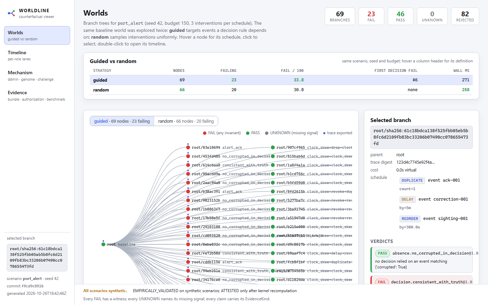
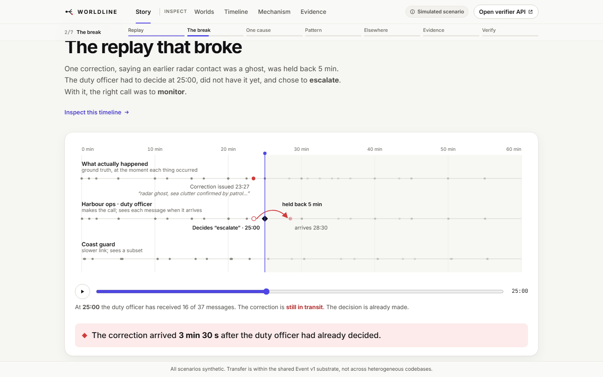
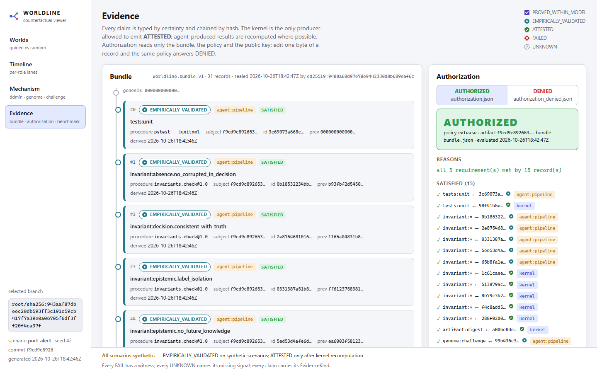
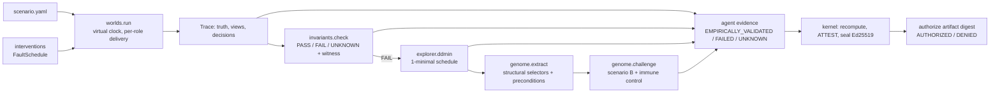

# WORLDLINE

**A counterfactual computing substrate: run a system in many worlds, isolate the one difference that breaks a guarantee, turn it into a portable failure mechanism, and let nothing deploy on evidence it cannot type.**

[](https://gitlab.com/shafir2/WorldLine/-/pipelines)
[](LICENSE)


> Built for the GitLab Transcend "Life After Code" hackathon as the first laboratory of a longer research program. Every number in this file was written by code that ran; see [Evidence and claim ceilings](#evidence-and-claim-ceilings).



| Timeline with information lag and the FAIL witness | Evidence chain and release authorization |
|---|---|
|  |  |

## Contents

[Why](#why) · [What it does](#what-it-does) · [The headline result](#the-headline-result) · [Features](#features) · [Tech stack](#tech-stack) · [Getting started](#getting-started) · [Usage](#usage) · [Project structure](#project-structure) · [Architecture](#architecture) · [GitLab Duo integration](#gitlab-duo-integration) · [Testing](#testing) · [Deployment](#deployment) · [Evidence and claim ceilings](#evidence-and-claim-ceilings) · [Roadmap and limitations](#roadmap-and-limitations) · [Contributing](#contributing) · [License](#license) · [Author](#author)

## Why

A change is normally judged against one world: the test suite's. Tests pass, the pipeline is green, an agent writes a confident explanation, the release ships. The failures that matter live in other worlds: the one where the correcting report arrived ninety seconds later, where a permission was revoked mid-run, where two correct components composed into a wrong decision. Nothing in a conventional pipeline asks about those worlds, and nothing distinguishes "the tests passed" from "this is known to hold".

WORLDLINE asks: **what would this system do if the world were different, and which differences actually matter?** And it refuses to let an agent certify its own work.

## What it does

1. **Runs a scenario deterministically** with a virtual clock. Simulated truth, each role's received observations, and evaluator conclusions are separate stores with separate clocks. A role only ever knows what it has received.
2. **Branches the history** by injecting environmental interventions at the delivery layer: delay, drop, duplicate, reorder, corrupt, revoke, clock skew.
3. **Checks three-valued invariants** (PASS, FAIL, UNKNOWN) with witnesses: temporal response, label isolation, no-future-knowledge, and `decision.consistent_with_truth`, which fires when an actor's rule-based decision differs from what the same rule says over truth, because of information that had not yet arrived.
4. **Minimizes** any failing world with delta debugging to a 1-minimal set of interventions and independently re-checks minimality.
5. **Extracts a FailureGenome**: the mechanism abstracted to structural selectors ("the last correcting report a deciding role received before its decision") and preconditions, with no event ids.
6. **Challenges a second scenario** with the genome. Different domain, roles, rules. Reports reproduced, not reproduced, or preconditions unmet. A deliberately immune variant acts as the negative control.
7. **Types every claim** as PROVED_WITHIN_MODEL, EMPIRICALLY_VALIDATED, ATTESTED, FAILED or UNKNOWN, chains and Ed25519-seals the evidence, and **authorizes a release** only when a policy over those kinds is met for the exact artifact digest. Agents can never emit ATTESTED; the kernel recomputes what they report, and a mismatch becomes a FAILED integrity record that denies the release.

## The headline result

Scenario A, `port_alert`: a synthetic port security incident with three roles at different latencies. The duty officer decides at 1500 s whether to escalate, based on sightings not yet corrected. In the baseline, a correction arrives in time and the decision is "monitor".

Scenario B, `convoy_lostlink`: a synthetic logistics convoy with an uncrewed scout. Different roles, event kinds, decision rules and timings, written without reference to A's defect.

What the pipeline did on this machine (`uv run worldline demo --budget 150 --seed 42`):

| Step | Result |
|---|---|
| Explore A, guided | 69 branches, 23 failing, first decision failure at branch 6 |
| Explore A, random baseline | 66 branches, 20 failing, no decision failure within budget |
| Minimize a 3-intervention failing schedule | 1 intervention, 3 oracle calls, 1-minimality verified |
| Minimal intervention | delay `correction-001` to `harbour_ops` past the decision |
| Genome | "delay the last correcting report a deciding role received before its decision until after the decision" |
| Challenge B | **reproduced**: delaying `retract-001` to `ops_center` flips the watch officer to "reroute" while truth says "continue" |
| Immune control (B with a two-report rule) | preconditions met, **not reproduced** |
| Kernel verify | 31 records, 16 ATTESTED by kernel, 0 agent-report mismatches |
| Authorize exact commit | AUTHORIZED, 5 of 5 requirements |
| Authorize tampered bundle | DENIED: `integrity:record_edited@1` |

Benchmark across seeds 1 to 5, budget 150 (`experiments/out/benchmark.json`):

| Metric (mean over 5 seeds) | guided | random |
|---|---|---|
| failing branches per 100 run | 44.5 | 30.5 |
| index of first `decision.consistent_with_truth` failure | 3.4 | 14.0 |
| wall ms per exploration | 256 | 293 |

Minimization over five failing schedules of size 3 to 4: every one reduced to a single intervention, mean 3.4 oracle calls, 1-minimality verified in all five. The five minimal mechanisms were not all the same: drop the correction, corrupt the correction's `corrects` field, revoke the deciding role's feed from 1350 s, and corrupt the alert acknowledgement. Random exploration also found a mechanism the guided strategy did not prioritise: duplicating a sighting flips the decision, because the rule has no de-duplication.

Claim ceiling: EMPIRICALLY_VALIDATED on two synthetic scenarios on one machine. Transfer is across scenarios sharing the Event v1 substrate, not across heterogeneous codebases.

## Features

- Deterministic virtual clock, forkable seeded PRNG, hash-chained append-only event logs; same inputs give byte-identical digests.
- Four notions of time that are never merged: event time, receipt time per role, derivation time, simulated-truth time.
- Snapshot and branch with an identical replayed prefix.
- `AS_KNOWN_AT(t)` and `AS_OBSERVED_AT(t)` queries per role.
- Safe predicate DSL for decision rules (no `eval`).
- Seven intervention operators and mutators; schedules that violate the time rule are recorded as rejected, never hidden.
- Three-valued invariant checker with minimal witnesses; UNKNOWN names the missing signal.
- Guided versus random exploration on one budget; the guided strategy reads only the scenario, never runtime truth.
- Delta debugging with an independent 1-minimality witness.
- FailureGenome extraction, preconditions, and cross-scenario challenge with negative control.
- Typed evidence records, Ed25519-sealed bundles with distinct tamper findings (edited, dropped, reordered, wrong key, truncated), policy-based authorization, assumption revocation.
- A kernel that recomputes agent claims before attesting them.
- Static viewer: branch tree, per-role timelines with information-lag lines, scrubber, causal diff, mechanism cards, evidence chain.
- GitLab CI pipeline: test, explore, kernel-verify, authorize, pages; kernel jobs isolated by protected refs and CODEOWNERS.

## Tech stack

Python 3.12, PyYAML, Typer, Rich, cryptography (Ed25519); pytest and Hypothesis. Viewer: Vite 6, React 18, TypeScript 5, hand-written CSS and SVG, no UI kit. uv for environments. GitLab CI and GitLab Duo Agent Platform.

## Getting started

Prerequisites: Python 3.12 or newer and [uv](https://docs.astral.sh/uv/). Node 20 or newer only for the viewer.

```bash
git clone https://gitlab.com/shafir2/WorldLine.git
cd WorldLine
uv sync --extra dev
uv run pytest -q
uv run worldline demo --out experiments/out --budget 150 --seed 42
```

The demo ends with `AUTHORIZED` followed by a `DENIED` on a deliberately tampered bundle, and leaves every artifact in `experiments/out/`.

Viewer:

```bash
cd ui
npm ci
npm run build      # copies ../experiments/out into dist/data
npm run preview
```

No environment variables are needed locally. CI needs one protected variable, `WORLDLINE_KERNEL_KEY`, holding the Ed25519 private key produced by `uv run worldline keygen`; the matching public key is committed at `policies/kernel_public.pem`.

## Usage

```bash
# one world
uv run worldline run scenarios/port_alert.yaml --out experiments/out

# many worlds, both strategies, writes exploration.json and traces of failing branches
uv run worldline explore scenarios/port_alert.yaml --budget 200 --seed 42 --out experiments/out

# reduce the chosen failing schedule to a 1-minimal one, with causal diff against root
uv run worldline minimize experiments/out/exploration.json --out experiments/out

# abstract the mechanism, then challenge another scenario (immune control picked up automatically)
uv run worldline genome extract experiments/out/minimal_schedule.json --out experiments/out/genome.json
uv run worldline genome challenge experiments/out/genome.json scenarios/convoy_lostlink.yaml --seed 42 --out experiments/out/challenge.json

# agent-side evidence, then the independent kernel
uv run worldline report experiments/out --code-commit $(git rev-parse HEAD)
uv run worldline verify experiments/out --signing-key policies/kernel_private.pem --public-key policies/kernel_public.pem --out experiments/out/bundle.json
uv run worldline authorize experiments/out/bundle.json --policy policies/release.yaml --public-key policies/kernel_public.pem --artifact-digest $(git rev-parse HEAD) --out experiments/out/authorization.json

# show that invalidating an assumption revokes authorization
uv run worldline authorize experiments/out/bundle.json --policy policies/release.yaml --public-key policies/kernel_public.pem --artifact-digest $(git rev-parse HEAD) --invalidate-assumption "bounded horizon" --out /tmp/revoked.json

# benchmark guided vs random over seeds
uv run python experiments/benchmark.py --seeds 5 --budget 150 --out experiments/out/benchmark.json
```

Writing a scenario: copy `scenarios/port_alert.yaml`. Roles declare delivery latency, jitter, ordering and visible policy labels. Actors declare decision rules in the predicate DSL, for example `count(kind='sighting', payload.confidence>=0.6, not_corrected) >= 2`. Invariants live in `invariants/core.yaml`.

## Project structure

```
worldline/
  core/            Event v1, hash-chained EventLog, VirtualClock, DeterministicRNG
  worlds/          scenario grammar, deterministic runner, snapshot/branch, views, predicate DSL
  interventions/   delay/drop/duplicate/reorder/corrupt/revoke/clock_skew, mutators
  invariants/      three-valued checker with witnesses
  explorer/        explore (guided vs random), ddmin, minimize, causal_diff
  genome/          FailureGenome extract and challenge
  evidence/        typed records, sealed Bundle, Policy, authorize, kernel recompute
  cli/             `worldline` command
scenarios/         port_alert, convoy_lostlink, convoy_lostlink_immune (negative control)
invariants/        core.yaml
policies/          release.yaml, kernel_public.pem
experiments/       benchmark.py; out/ is generated and ignored
ui/                Vite + React viewer
tests/             158 tests
docs/              ARCHITECTURE, THESIS (prior art), REPORT (measurements), ROADMAP, HANDOVER, GitLab setup, Duo agent prompts
.gitlab-ci.yml     test -> explore -> kernel-verify -> authorize -> pages
AGENTS.md, CODEOWNERS, .gitlab/duo/   agent guidance and protected paths
```

## Architecture



Trust boundary: everything left of the kernel may be produced or modified by agents. The kernel reads only the committed public key, the policy, and the bundle, recomputes verdicts from traces, and is the sole producer of ATTESTED records. `invariants/`, `policies/`, `worldline/evidence/` and the kernel CI jobs are protected by CODEOWNERS. Full contracts in [docs/ARCHITECTURE.md](docs/ARCHITECTURE.md); thesis and prior art in [docs/THESIS.md](docs/THESIS.md).

## GitLab Duo integration

What actually ran on GitLab, all inspectable:

| Step | Actor | Link |
|---|---|---|
| Witness filed | pipeline output | [issue 1](https://gitlab.com/shafir2/WorldLine/-/work_items/1) |
| Investigation: re-ran exploration, confirmed identical digests, minimized, reported | Duo agent, WORLDLINE Investigate flow | [session 10080962](https://gitlab.com/shafir2/WorldLine/-/automate/agent-sessions/10080962) |
| Repair proposed under the contract | Duo agent, WORLDLINE Repair flow | [merge request 1](https://gitlab.com/shafir2/WorldLine/-/merge_requests/1), [session 10081188](https://gitlab.com/shafir2/WorldLine/-/automate/agent-sessions/10081188) |
| Review found the repair vacuous (escalation unreachable) | GitLab Duo Code Review | comments on MR 1 |
| Review addressed with a reachability variant | Duo agent, WORLDLINE Repair flow | [session 10081957](https://gitlab.com/shafir2/WorldLine/-/automate/agent-sessions/10081957) |
| Independent review: FAIL, repair sidesteps the fault and does not land on the target scenario | Duo agent, WORLDLINE Skeptic flow | [session 10081961](https://gitlab.com/shafir2/WorldLine/-/automate/agent-sessions/10081961) |

The merge request is deliberately left open: the Skeptic is right, and the fix it demands is a design decision recorded in [docs/HANDOVER.md](docs/HANDOVER.md). Agents were created from the prompts in this repository through the catalog API (`scripts/duo_setup.py`).

Three custom agents, prompts in [docs/duo/](docs/duo/): **Investigator** reads a FAIL witness and the genome and writes an issue; **Repairer** proposes a fix as a merge request under the repair contract in [AGENTS.md](AGENTS.md) (make the failing branch PASS without weakening invariants, add a regression scenario); **Skeptic** reviews merge requests for claims not backed by typed evidence. Flows in [docs/duo/flows.md](docs/duo/flows.md) trigger the Investigator from a work item and the Skeptic on merge request creation. The pipeline's `kernel-verify` and `authorize` stages decide; agents never do. Setup steps are in [docs/GITLAB_SETUP.md](docs/GITLAB_SETUP.md). Autonomy tier: Supervised.

## Testing

```bash
uv run pytest -q                 # 158 tests: unit, property, integration, CLI
uv run pytest -q tests/test_evidence.py   # tamper findings, agent cannot self-attest, revocation
cd ui && npm run build           # type-checks with strict TypeScript
```

## Deployment

The `pages` CI job builds the viewer and publishes it with the pipeline's own `experiments/out` as data, so the published page shows what the pipeline actually computed. The viewer is static and can also be served from any bucket or Cloud Run container; there is no backend.

## Evidence and claim ceilings

| Claim | Kind | Basis |
|---|---|---|
| Same inputs give identical trace digests | EMPIRICALLY_VALIDATED | tests incl. subprocess re-run |
| Views never contain information before receipt | EMPIRICALLY_VALIDATED | `epistemic.no_future_knowledge` on every trace, plus tests |
| Minimal schedules are 1-minimal | EMPIRICALLY_VALIDATED | independent `one_minimal_check` on every minimization |
| Guided exploration finds more failing worlds than random | EMPIRICALLY_VALIDATED | 5 seeds, one scenario, one machine |
| Genome transfers between scenarios | EMPIRICALLY_VALIDATED | one positive scenario, one immune control |
| Tampered or agent-forged evidence cannot authorize | EMPIRICALLY_VALIDATED | tests and demo |
| Anything about real deployments, real C2 systems, or heterogeneous codebases | UNKNOWN | not attempted |

Nothing here is PROVED_WITHIN_MODEL yet. All scenarios are synthetic and labelled as such.

## Roadmap and limitations

Limitations now: two scenarios, one invariant family drives the headline; transfer is substrate-internal; no partial-order reduction, so exploration is budget-bound; delay values are swept, not solved; the Duo flow definitions were only partly verifiable against official documentation at build time. The roadmap, with the experiment that would settle each item, is in [docs/ROADMAP.md](docs/ROADMAP.md).

## Contributing

Open an issue with a scenario that you believe should fail and does not, or a genome that reproduces where it should not. Pull requests must keep `uv run pytest -q` green and must not touch `invariants/`, `policies/` or `worldline/evidence/` without a CODEOWNERS review.

## License

MIT. See [LICENSE](LICENSE).

## Author

shafir-01
