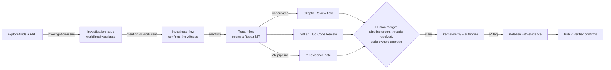

# The WORLDLINE workflow on GitLab

WORLDLINE lives where your team already works: issues, merge requests, pipelines and releases. Agents find and fix failures; the kernel decides what ships. This page walks through that loop end to end, with the exact job names, labels, templates and permissions, so a team can adopt it as is.



## The pieces

| Piece | Where | What it does |
|---|---|---|
| `explore` | `.gitlab-ci.yml`, every pipeline | Explores the scenario under fault interventions, minimises the failing schedule, extracts the failure genome, challenges it on a second scenario. Writes `experiments/out/`. |
| `kernel-verify`, `authorize` | `.gitlab-ci.yml`, protected refs, MRs to `main`, tags | The kernel. Recomputes every verdict, seals the evidence bundle with `WORLDLINE_KERNEL_KEY`, and decides AUTHORIZED or DENIED against `policies/release.yaml`. |
| `mr-evidence` | `.gitlab/ci/review.yml`, MR pipelines | Posts one note on the MR, edited in place on every pipeline: the kernel decision (or "kernel did not run on this ref"), invariant verdicts for the root and minimal traces, the minimal schedule in plain English, the genome and its challenge outcome, links to the pipeline and evidence files, and the claim ceiling. |
| `investigation-issue` | `.gitlab/ci/review.yml`, manual, protected refs | Opens or updates the tracking issue for the current finding, labelled `worldline:investigate`, and mentions the Investigate flow's service account. |
| `duo-repair` | `.gitlab-ci.yml`, manual, protected refs | Starts the Repair flow from a DENIED pipeline through the Flows API. |
| `release-assets`, `release` | `.gitlab-ci.yml`, `v*` tags | Publishes the sealed bundle and the kernel's authorization with the release. |
| `deploy-gcp` | `.gitlab/ci/gcp.yml`, manual, protected refs | Deploys the public verifier to Cloud Run. |
| WORLDLINE Investigate / Repair / Skeptic Review | AI Catalog flows, `docs/duo/flows.md` | The three agents. Service accounts `ai-worldline-investigate-<group>`, `ai-worldline-repair-<group>`, `ai-worldline-skeptic-review-<group>` (on this project: `-shafir`). |
| Templates | `.gitlab/issue_templates/`, `.gitlab/merge_request_templates/` | **Investigation** and **Scenario proposal** issues; **Repair** merge request. |
| Labels | project labels | `worldline:investigate` (investigations), `worldline:repair` (repair MRs), `worldline:scenario` (scenario proposals). Labels organise the board; they never fire a flow. |

## 1. Open an investigation

A finding starts as an issue. There are two ways in.

**From the pipeline.** On a protected ref (normally `main`), open the pipeline and run the manual job **`investigation-issue`**. It reads the `explore` output of that pipeline and:

- opens an issue titled `Investigate: <invariant> FAIL on <scenario> (<genome id>)`, using the Investigation layout: witness, minimal schedule as JSON and in plain English, explanation, genome, transfer result, verdict table, reproduce commands, and the repair contract as a checklist;
- labels it `worldline:investigate`;
- comments `@ai-worldline-investigate-<group> investigate <scenario> seed <seed> budget <budget> ...`, which hands it to the Investigator.

Run it again for the same invariant and genome and it updates that issue instead of opening a second one (the issue carries a hidden marker keyed by invariant and genome). It mentions the Investigator again only if you run the job with `WORLDLINE_RETRIGGER=1`.

**By hand.** New issue > template **Investigation**. Fill in the scenario, invariant, witness and schedule, then mention the Investigate service account in a comment. Ideas for new worlds to explore use the **Scenario proposal** template (label `worldline:scenario`).

## 2. The agent investigates

The **WORLDLINE Investigate** flow fires on a mention of its service account, or when a work item is created (its two triggers). It runs `explore`, `minimize` and `genome extract` on the named scenario, checks determinism by running twice, and posts one comment: `## Investigation: <scenario> seed <seed> budget <budget>` with the witness, the minimal schedule, the genome, digests and a recommended repair target. It is read-only: no file edits, no MRs, no kernel commands.

A human reads the comment and decides whether the finding deserves a repair.

## 3. Repair, under contract

Hand the issue to the Repairer by commenting `@ai-worldline-repair-<group> repair this issue under the AGENTS.md contract`, or, from a DENIED pipeline on a protected ref, run the manual **`duo-repair`** job. The **WORLDLINE Repair** flow opens one merge request per invariant on a branch `repair/<invariant>-<short>`. Humans opening a repair MR pick the **Repair** template, label `worldline:repair`.

The Repair template is the contract from `AGENTS.md`, as checkboxes:

- **Product, not specimen.** The failing branch yields PASS on `scenarios/product/<file>.yaml`. Specimens under `scenarios/` are deliberately defective and frozen.
- **Specimen still fails.** A test shows the specimen still FAILs under the same schedule, so the fix is not a deleted test case.
- **No weakening.** `invariants/`, `policies/`, `worldline/evidence/` untouched; no check made more permissive.
- **Regression.** `scenarios/regressions/<invariant>_<short>.yaml` with the concrete schedule, plus a test.
- **Tests.** `uv run pytest -q` passes; nothing deleted, skipped or xfailed.
- **Description.** Invariant and version, witness before, mechanism, change, claim ceiling (never ATTESTED).
- **Determinism.** No wall clock, no randomness outside `DeterministicRNG`, no LLM in the decision path.
- **Non-vacuity.** The repaired rule still reaches its non-default option when the evidence supports it.
- **Not a deletion.** The fault inject was not removed or softened.

## 4. Skeptic and Code Review

Three reviewers read every repair MR, independently:

- **WORLDLINE Skeptic Review** fires on *Merge request created*. It checks boundaries, weakening, the reproduced claim, the regression scenario, determinism and honesty, and posts exactly one `## Skeptic review: PASS|FAIL` note. It never approves or merges.
- **GitLab Duo Code Review** (`duo-code-review-<group>`) reviews the diff as code. Its threads must be resolved before merge.
- **`mr-evidence`** posts what the pipeline actually measured. It is the shared ground truth the other two argue about.

Merge checks enforce the outcome: the project requires **pipelines must succeed** and **all threads resolved**, and `main` requires **code owner approval** (`CODEOWNERS`: `invariants/`, `policies/`, `worldline/evidence/`, `.gitlab-ci.yml`, `.gitlab/duo/`, `AGENTS.md` belong to the maintainer). An agent can propose; only a person with Maintainer rights can merge.

## 5. The kernel decides

`kernel-verify` and `authorize` run where `WORLDLINE_KERNEL_KEY` is visible: protected branches and protected `v*` tags. They recompute every claim from the traces, seal the bundle and decide against `policies/release.yaml`. Agents produce evidence of kind `EMPIRICALLY_VALIDATED` at best; only the kernel emits `ATTESTED`.

On an MR from an unprotected branch the key is not visible, so `mr-evidence` reports **kernel did not run on this ref** rather than showing a decision. A decision is shown only if `authorization.json` was issued for the pipeline's own commit (`artifact_digest == CI_COMMIT_SHA`); a stale or foreign decision is never displayed. After merge, the `main` pipeline runs the kernel on the merged commit.

## 6. The release carries its evidence

A maintainer tags `v*`. The tag pipeline runs the kernel again for the tagged commit; if it is AUTHORIZED, `release-assets` uploads `bundle.json`, `authorization.json`, `genome.json`, `minimal_schedule.json`, `challenge.json` and `index.json` to the generic package registry (`worldline-evidence/<tag>/`) and `release` creates the GitLab release with the decision, the bundle root and a SHA-256 for every file. A DENIED tag never becomes a release. Details: [RELEASES.md](RELEASES.md).

## 7. The verifier confirms

Anyone can check a release without CI access, without trusting the runner and without the private key:

```
BASE=https://worldline-verifier-301330323690.europe-north1.run.app
TAG=v0.1.3-transcend
curl -sLo bundle.json "https://gitlab.com/api/v4/projects/88121109/packages/generic/worldline-evidence/$TAG/bundle.json"
curl -s -X POST "$BASE/api/verify" -H 'content-type: application/json' --data-binary @bundle.json
curl -s -X POST "$BASE/api/authorize?artifact_digest=<tag commit>" -H 'content-type: application/json' --data-binary @bundle.json
```

The verifier re-checks the hash chain and the Ed25519 checkpoint against the committed public key and re-evaluates the release gate. It can verify; it can never seal or authorize. The next `deploy-gcp` adds `GET /api/verify/release?tag=<tag>`, which fetches the bundle from the package registry itself. Offline: `uv run worldline authorize bundle.json --policy release.yaml --public-key kernel_public.pem --artifact-digest <commit>`.

The project page shows three badges: **pipeline** (status of `main`), **release** (latest tag) and **verifier** (links to the live verifier).

## Permissions and setup

| What | Who or what needs it | How |
|---|---|---|
| Merge to `main`, create `v*` tags | Maintainers | Protected branch and protected tag rules (docs/GITLAB_SETUP.md section 1) |
| Approve kernel paths | Code owners | `CODEOWNERS` plus "Require approval from code owners" on `main` |
| Merge checks | Project | Settings > Merge requests: "Pipelines must succeed" and "All threads must be resolved" (both on) |
| `WORLDLINE_KERNEL_KEY` | `kernel-verify` only | Protected, File variable |
| `WORLDLINE_BOT_TOKEN` | `mr-evidence`, `investigation-issue` | Project access token, role **Reporter**, scope **api**; CI variable masked and protected. `CI_JOB_TOKEN` cannot write notes or issues, so without it `mr-evidence` prints the note to the job log and saves `mr_evidence.md` as an artifact, and `investigation-issue` is not offered. |
| `WORLDLINE_DUO_TOKEN`, `WORLDLINE_REPAIR_FLOW_CONSUMER_ID` | `duo-repair` | docs/GITLAB_SETUP.md section 2 |
| `WORLDLINE_INVESTIGATE_ACCOUNT` (optional) | `investigation-issue` | Overrides the service account to mention; by default the job finds the project member whose username starts with `ai-worldline-investigate-` |
| Flow service accounts | Duo Agent Platform | Created when each flow is enabled; Developer on the project (docs/GITLAB_SETUP.md section 5) |

Because `WORLDLINE_BOT_TOKEN` is protected, the note is written on MR pipelines only when GitLab exposes protected variables to that pipeline; on other MRs the note is in the `mr-evidence` job log and artifact. Unprotect the variable if every MR should get the note (it can write notes and issues, nothing more than its Reporter role allows).

Create the token:

```powershell
# Settings > Access tokens > Add new token: name worldline-bot, role Reporter, scope api
glab variable set WORLDLINE_BOT_TOKEN --masked --protected --value "<token>"
```

Badges and merge checks were set through the API:

```powershell
glab api -X POST projects/88121109/badges -f name=pipeline -f "link_url=https://gitlab.com/%{project_path}/-/pipelines?ref=%{default_branch}" -f "image_url=https://gitlab.com/%{project_path}/badges/%{default_branch}/pipeline.svg"
glab api -X POST projects/88121109/badges -f name=release  -f "link_url=https://gitlab.com/%{project_path}/-/releases" -f "image_url=https://gitlab.com/%{project_path}/-/badges/release.svg"
glab api -X POST projects/88121109/badges -f name=verifier -f "link_url=https://worldline-verifier-301330323690.europe-north1.run.app" -f "image_url=https://img.shields.io/badge/verifier-live-2ea44f?logo=googlecloud&logoColor=white"
glab api -X PUT  projects/88121109 -F only_allow_merge_if_pipeline_succeeds=true -F only_allow_merge_if_all_discussions_are_resolved=true
```

## Try the comment locally

`scripts/mr_comment.py` uses only the standard library. Render what the MR note and the investigation issue would say for your local `experiments/out`, without calling GitLab:

```
uv run python scripts/mr_comment.py mr --out experiments/out --dry-run
uv run python scripts/mr_comment.py issue --out experiments/out --dry-run
```

Tests: `uv run pytest -q tests/test_mr_comment.py`.

## Claim ceiling

Everything an agent or a review job posts is `EMPIRICALLY_VALIDATED` on synthetic scenarios at best. A claim becomes `ATTESTED` only when the kernel recomputes it, and a release is only as strong as its authorization says. Genome transfer is within the shared Event v1 substrate across scenarios, not across codebases.
