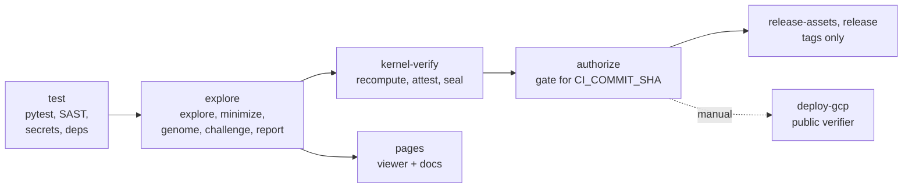

# GitLab workflow

On GitLab, every push runs the full chain, and the kernel decides whether a commit may ship. This page explains the flow. For the step-by-step project setup (protected refs, variables, and Duo agents), see [GitLab setup (full)](gitlab-setup.md).

## The pipeline

| Stage | Job | Runs on | What it decides |
|---|---|---|---|
| test | `test`, security scans, `docs` | every pipeline | Tests pass, and the docs build in strict mode. |
| explore | `explore` | every pipeline | Writes `experiments/out/` for the commit. |
| kernel-verify | `kernel-verify` | protected refs, MRs to the default branch, tags | Recomputes every claim and seals the bundle with `WORLDLINE_KERNEL_KEY`. |
| authorize | `authorize` | same as kernel-verify | AUTHORIZED or DENIED for this exact commit. A DENIED fails the pipeline. |
| release | `release-assets`, `release` | `v*` tags | Publishes the evidence as release assets, but only if AUTHORIZED. |
| pages | `pages` | default branch | Publishes the viewer at `/` and this documentation at `/docs/`. |

## What protects what

- **Protected variable.** `WORLDLINE_KERNEL_KEY` (type File) is visible only on protected branches and tags. On any other ref, `kernel-verify` fails loudly with "requires a protected ref".
- **CODEOWNERS.** `invariants/`, `policies/`, `worldline/evidence/`, `.gitlab-ci.yml`, `.gitlab/duo/`, `AGENTS.md`, and `CODEOWNERS` need an owner's approval.
- **Protected tags.** Only Maintainers create `v*` tags, so only they can cut a sealed release.

## Agents in the loop

Three GitLab Duo flows work on issues and merge requests. Agents never evaluate their own work, and the kernel stages decide.

| Flow | Trigger | Does |
|---|---|---|
| WORLDLINE Investigate | work item, mention | Re-runs the exploration, checks determinism, minimizes, and posts the witness and genome. Read-only. |
| WORLDLINE Repair | mention | Opens a merge request under the repair contract in `AGENTS.md`. |
| WORLDLINE Skeptic Review | merge request | Flags unbacked claims, protected-path edits, and vacuous repairs. |

When the gate is DENIED, the manual `duo-repair` job can hand the failure to the Repair flow.

## A typical change

1. Push a branch and open a merge request. `test` and `explore` run, and the kernel jobs run for MRs that target the default branch.
2. Read `authorization.json` in the job artifacts. A DENIED lists every unmet requirement.
3. Merge after review. On the default branch, `pages` republishes the viewer and these docs from that pipeline's own output.
4. Tag `v*` to release. See [Releases and verification](releases.md).
