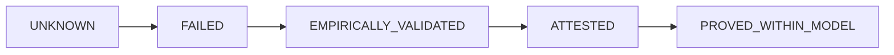

# Evidence kinds

Every claim WORLDLINE makes is a typed **evidence record**. The type says how the claim was obtained, and a release policy can require a minimum type.

## The five kinds

| Kind | Meaning | Who may produce it |
|---|---|---|
| `PROVED_WITHIN_MODEL` | Proven, within a stated model. | Kernel only (nothing is at this level yet) |
| `ATTESTED` | The kernel recomputed the claim itself, and it matched. | **Kernel only** |
| `EMPIRICALLY_VALIDATED` | Observed by running code: tests, verdicts over traces, benchmarks. | Agents and kernel |
| `FAILED` | Checked, and it does not hold. | Agents and kernel |
| `UNKNOWN` | Not decidable with the data at hand. | Agents and kernel |

For requirements, the certainty order is:

FAILED and UNKNOWN never satisfy a requirement.

## What a record carries

`id`, `kind`, `claim` (for example `invariant:decision.consistent_with_truth` or `tests:unit`), `subject` (the artifact or trace digest the claim is about), `procedure`, `inputs_hash`, `result`, `assumptions` (for example "bounded horizon 3600s"), `derived_at`, and `producer` (`kernel` or `agent:<name>`).

Two rules give the kinds their teeth:

1. **Agents can never emit ATTESTED.** `Bundle.add` refuses it, and the policy's `forbid_producers_for_kinds` refuses it again at authorization.
2. **Assumptions are part of the claim.** Invalidating a listed assumption revokes an authorization that depended on it (`worldline authorize --invalidate-assumption`).

## Claim ceilings

Public claims carry their kind. WORLDLINE's own headline results are EMPIRICALLY_VALIDATED on synthetic scenarios on one machine, and nothing is PROVED_WITHIN_MODEL yet. The [technical report](../research/report.md) states the ceiling for each claim.

Related: [The kernel](kernel.md).
