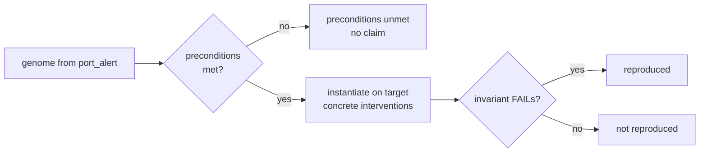

# Failure genome

A minimal schedule names concrete events, such as `correction-001`. A **failure genome** abstracts the same cause into structure, so that it can be tried against a different system.

## From instance to mechanism

| Minimal schedule (concrete) | Genome (abstract) |
|---|---|
| delay `correction-001` to `harbour_ops` past the decision | delay the **last `correction` before the decision** that **corrects a dependency** of the rule, seen by the **deciding role**, until **after the decision** |

A genome holds the following:

- **mechanism**: steps with structural selectors (kind, relation such as `corrects_dependency`, position such as `last_before_decision`, and the symbolic `decision_role`). It never holds event ids.
- **preconditions**: structural features a target must have, for example `has_decision_rule`, `decision_rule_depends_on_a_corrected_kind`, and `exists_kind:correction:with_payload_field:corrects`.
- **witness_shape** and **origin**: the scenario, seed, branch, trace digest, schedule hash, and code commit it came from.

## Challenge, with a negative control

`worldline genome challenge` checks the preconditions against a second scenario, instantiates the mechanism there, runs the branch, and reports one of three outcomes. It also runs **immune controls**: scenarios written to meet the preconditions and still be immune. By default the control is `scenarios/convoy_lostlink_immune.yaml`, and you can name others with `--immune`. For a control, "preconditions met, not reproduced" is the correct outcome.

| Target | Preconditions | Reproduced |
|---|---|---|
| `convoy_lostlink`: different domain, roles, and rules | met | **yes**: the watch officer reroutes while truth says continue |
| `convoy_lostlink_immune`: the rule needs two credible reports | met | **no**, which is correct |

!!! warning "Claim ceiling"
    Transfer is shown across scenarios that share the Event v1 substrate. It is not transfer across heterogeneous codebases. Testing a genome against an instrumented real service is on the [roadmap](../research/roadmap.md).

Related: [CLI: genome extract](../reference/cli.md#worldline-genome-extract), [CLI: genome challenge](../reference/cli.md#worldline-genome-challenge).
