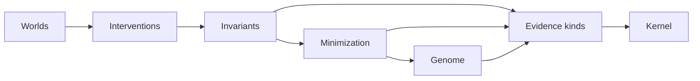

# Concepts

WORLDLINE has seven ideas. Each one has its own page, and each page builds on the ones before it.

| Concept | One line |
|---|---|
| [Worlds](worlds.md) | A deterministic simulation where truth, what each role has received, and what the evaluator concludes are kept apart. |
| [Interventions](interventions.md) | Changes to how the environment delivers events (delay, drop, duplicate, reorder, corrupt, revoke, clock skew), which branch one world into many. |
| [Invariants](invariants.md) | Guarantees that are checked in every world and return PASS, FAIL with a witness, or UNKNOWN with the missing signal. |
| [Minimization](minimization.md) | Delta debugging that reduces a failing set of interventions to a 1-minimal cause and checks that result independently. |
| [Failure genome](genome.md) | The cause, abstracted from event ids to structure, so that it can challenge a different scenario. |
| [Evidence kinds](evidence-kinds.md) | Every claim is typed by how it was obtained: PROVED_WITHIN_MODEL, EMPIRICALLY_VALIDATED, ATTESTED, FAILED, or UNKNOWN. |
| [The kernel](kernel.md) | The one component that recomputes agent claims, attests what matches, seals the evidence, and authorizes a release for one exact commit. |

