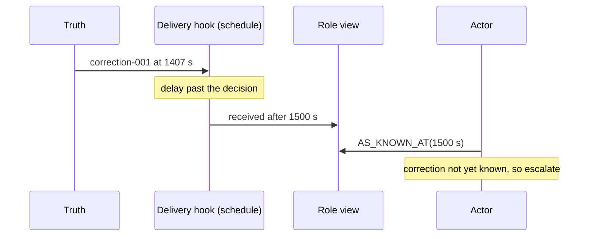

# Interventions

An **intervention** changes how the environment delivers one or more events to a role. A tuple of interventions is a **fault schedule**. Applying a schedule to the root world produces a branch.

## The seven operators

| Operator | Effect at delivery | Parameters |
|---|---|---|
| `delay` | Shifts the receipt time of the targeted delivery later. | `by_ns` |
| `drop` | Suppresses the delivery. | none |
| `duplicate` | Delivers extra copies (`<id>#dup<n>`) with provenance back to the original. | `count`, `spacing_ns` |
| `reorder` | Pushes a delivery past the next event of the same kind. | `by_ns`, or `margin_ns` |
| `corrupt` | Sets a payload field, lowers `quality`, and marks provenance. | `field`, `value`, `quality` |
| `revoke` | Cuts a role's feed from a point in time on. | `role`, `from_ns` |
| `clock_skew` | Offsets receipt times for everything from one source. | `source_id`, `offset_ns` |

A target is either concrete (`{"event_id": "correction-001"}`, optionally with a `role`) or abstract (kind, role, position). Abstract targets are what a [failure genome](genome.md) carries.

## Where interventions act

Interventions are applied when an event is delivered to a role, never to truth. A schedule that would make an event arrive before it happened breaks the time rule. Such a schedule is recorded as **rejected** and is never silently skipped.

## Exploration: guided versus random

`worldline explore` samples fault schedules of a fixed size within a budget, using two strategies:

- **Random** draws uniformly. It is the baseline.
- **Guided** prioritizes interventions that touch events the decision rules depend on. It reads only the scenario, never runtime truth, so the comparison is fair.

Both strategies run on the same budget and are reported side by side: failing branches per 100, the index of the first decision FAIL, and wall time. Duplicate schedules are deduplicated by hash and counted against the strategy that produced them.

Related: [CLI: explore](../reference/cli.md#worldline-explore), [Minimization](minimization.md).
