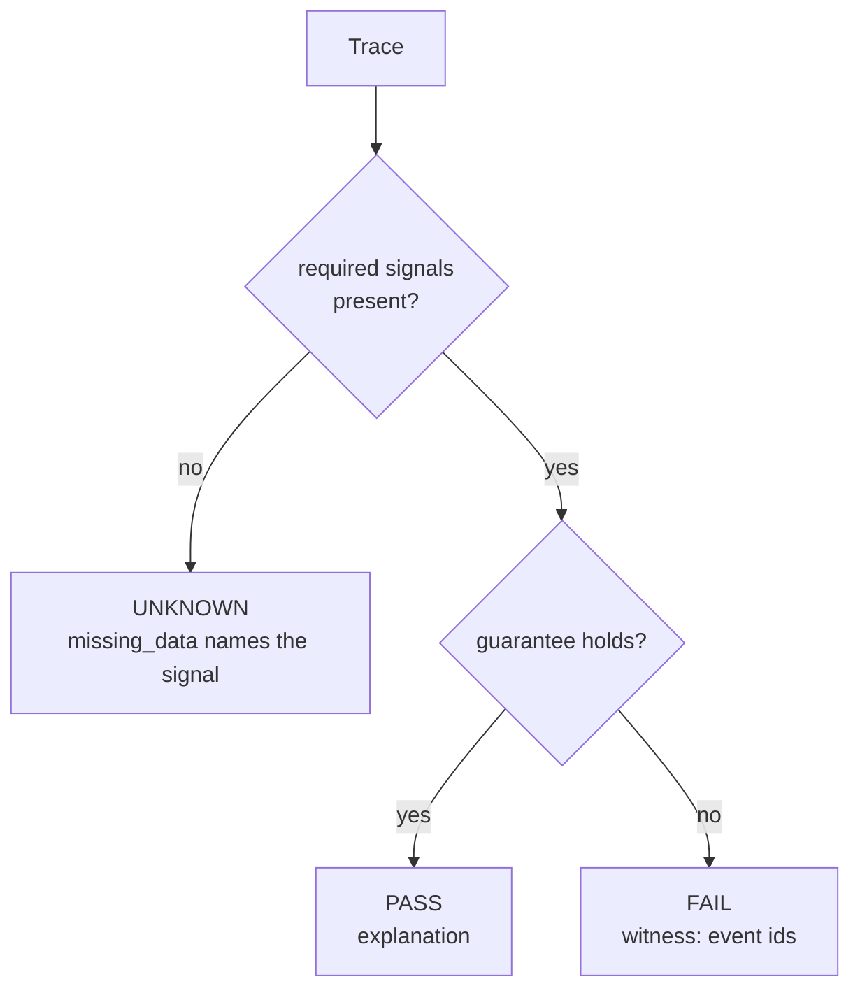

# Invariants

An **invariant** is a guarantee that is checked in every world. WORLDLINE's checker is three-valued, and every result carries its justification.

## Kinds

| Kind | Question it answers | Example |
|---|---|---|
| `epistemic` | Did anyone know something before they could have? Did a labelled event reach a role that may not see it? | `epistemic.no_future_knowledge`, `epistemic.label_isolation` |
| `response` | Was every trigger followed by a response in time, within one role's view? | `response.alert_ack`: every alert acknowledged within 300 s |
| `absence` | Did something that must never happen happen? | `absence.no_corrupted_in_decision` |
| `decision` | Was the decision the one the same rule gives over truth? | `decision.consistent_with_truth` |
| `always` | Does a state predicate over truth hold throughout? | `always.non_negative_capacity` |
| `latency`, `ordering`, `duplicate`, `quorum` | Did information arrive in time and in causal order, was it counted once, and did it come from enough independent sources? | `latency.bound`, `ordering.causal`, `duplicate.suppressed`, `quorum.independent_sources` |

The first five kinds are in `invariants/core.yaml`. The extended set in `invariants/extended.yaml` adds the last row, along with `decision.fault_attributed`, whose witness lists only the information the fault took away, and `epistemic.permitted_only`.

## The decision invariant

`decision.consistent_with_truth` turns "the decision was wrong because of information that had not arrived yet" into a first-class, witnessed failure. For each recorded decision, it re-evaluates the actor's rule over truth as of the decision time. If the options differ, the result is FAIL, and the witness is the list of truth events from before the decision that the role had not received. This invariant drives the headline result.

## Witnesses and UNKNOWN

- Every FAIL has a witness of event ids. That witness is what minimization and the genome build on.
- Every UNKNOWN names what was missing, for example a scenario with no `alert` events for a response invariant. UNKNOWN never satisfies a release requirement.

Invariants are versioned and live in `invariants/core.yaml`, a protected path. Agents can't weaken the guarantees they are judged by. The full list is in the [Invariants reference](../reference/invariants.md).
