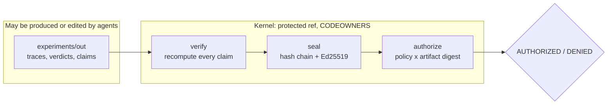

# The kernel

Agents, whether CI scripts, GitLab Duo flows, or people, produce traces, patches, and candidate evidence. The **kernel** decides. It is the only component that can attest, sign, and authorize.

## verify: recompute, then attest

`worldline verify` reads the output directory and recomputes every claim it can, independently of what the agents wrote. That covers the root and minimal-schedule verdicts (re-checked from the traces), both exploration strategies, the genome challenge and controls, 1-minimality, and the JUnit test totals. A match becomes an ATTESTED record with producer `kernel`. A mismatch becomes a FAILED `integrity:agent_report_mismatch` record, which denies the release. The kernel then seals the chain with a signed checkpoint and verifies it against the committed public key.

## authorize: a decision for one commit

`worldline authorize` reads only three things: the bundle, the policy (`policies/release.yaml`), and the public key. It then performs these checks:

1. It verifies the bundle. Each kind of tampering has a distinct finding: `record_edited`, `record_dropped`, `records_reordered`, `truncated`, `unsealed_tail`, `root_mismatch`, `unknown_signer`, `signature_invalid`, and `not_sealed`.
2. It binds subjects to the exact artifact digest (the commit).
3. It evaluates each requirement: claim pattern, minimum kind, required producer, no FAILED records, and maximum age.
4. It returns `AUTHORIZED` or `DENIED` with every reason. The exit code is 1 on DENIED, so CI fails.

## Trust boundary

- The private key exists only as the protected CI variable `WORLDLINE_KERNEL_KEY`, visible only on protected refs. The public key is committed.
- `invariants/`, `policies/`, `worldline/evidence/`, and the kernel CI jobs are protected by CODEOWNERS.
- Anyone can re-run `authorize` offline, or POST a bundle to the public [verifier](../reference/verifier-api.md), which holds only the public key.

!!! warning "What the kernel does not protect against"
    The kernel protects against agents misreporting what ran and against bundle tampering. It does not protect against a compromised CI runner or a stolen signing key. It also does not judge whether a repair is meaningful: a vacuous repair can pass. That gap belongs to review, as described in the [technical report](../research/report.md).

Related: [Releases and verification](../guides/releases.md), [CLI: verify](../reference/cli.md#worldline-verify), [CLI: authorize](../reference/cli.md#worldline-authorize).
