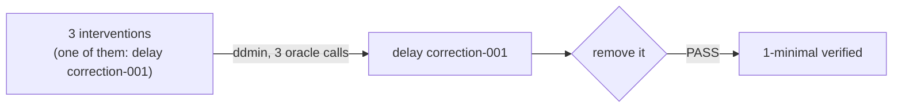

# Minimization

A failing branch usually carries several interventions, and most of them are irrelevant. **Minimization** finds a smallest sufficient cause.

## ddmin on fault schedules

`worldline minimize` applies Zeller and Hildebrandt's delta debugging (ddmin) to the failing schedule. The oracle is "does this subset still FAIL the target invariant?". The result is **1-minimal**: removing any single remaining intervention makes the branch pass.

## Independently checked

The minimizer's own claim isn't trusted. A separate `one_minimal_check` re-runs the minimal schedule, which must FAIL, and every single-removal variant, each of which must PASS. The result is recorded as `one_minimal_verified`, and the kernel recomputes it before attesting.

## What you get

`minimal_schedule.json` records the original and minimal schedules, the oracle calls and cache hits, every reduction step, the witness, an explanation, and a `causal_diff` against the root. The causal diff covers the decisions that changed and, per role, the receipt times that moved, and it confirms that truth is identical.

On `port_alert`, five failing schedules of size 3 to 4 each reduced to a single intervention in a mean of 3.4 oracle calls, with 1-minimality verified in all five. The minimal causes weren't all the same: four distinct failure classes of one decision rule appeared. See the [technical report](../research/report.md).

Related: [CLI: minimize](../reference/cli.md#worldline-minimize), [Failure genome](genome.md).
