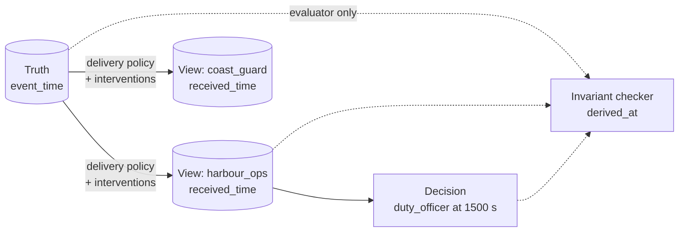

# Worlds

A **world** is one deterministic execution of a scenario. WORLDLINE runs the scenario once to get the **root** world, then branches it into many alternative worlds.

## What a world is made of

A scenario declares the following, all as data:

- **Truth.** The events that actually happen (`injects`) and changes to the world itself (`transitions`, such as an outage that silences a source).
- **Roles.** Observers, each with its own delivery policy (base latency, jitter, drop probability, ordering) and visibility (which policy labels it may see).
- **Actors.** Decision makers attached to a role, with rules written in a small, safe predicate language. An actor decides only from what its role has *received* by the decision time.
- **Invariants.** The guarantees to check in every world. See [Invariants](invariants.md).

## Three stores that are never merged

WORLDLINE keeps four notions of time apart: event time (when something happened), receipt time per role (when a role learned of it), derivation time (when the evaluator concluded something), and simulated-truth time. A role view holds only events whose `received_time_ns` is at or before the query time. Nothing in a view or a decision reads truth directly. The invariant `epistemic.no_future_knowledge` checks this in every world.

Two queries make the distinction usable:

- `AS_KNOWN_AT(role, t)`: everything the role has received by `t`.
- `AS_OBSERVED_AT(role, t)`: events that happened by `t` and that the role had also received.

## Determinism

Worlds run on a virtual clock that never reads wall time. All randomness, such as delivery jitter, comes from a seeded PRNG that is forked per purpose. Event logs are hash-chained. The same scenario, seed, and fault schedule give a byte-identical trace digest, both in-process and across a fresh interpreter. This is what lets a FAIL be replayed, minimized, and attested.

## Branches

A branch is the root world with a **fault schedule** applied at the delivery layer. Its id is `root/<schedule hash>`. Branching changes only how truth reaches roles. Truth itself is identical across branches, which is what makes "the decision changed because the information changed" a clean statement.

Related: [Scenario schema](../reference/scenario-schema.md), [Author a scenario](../guides/authoring.md).
