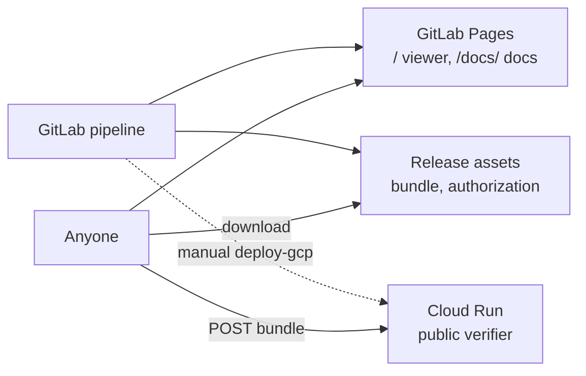

# Operations

This page covers running WORLDLINE's published pieces: the static site (viewer and docs), the public verifier, and the kernel key.



## GitLab Pages: viewer and docs

The `pages` job builds `ui/` against the pipeline's own `experiments/out/` and publishes the result at the site root. It copies the `docs` job's output to `/docs/`. Both are static and work under any subpath. The viewer is built with `base: './'`, and the docs use relative links.

Build the docs locally:

```bash
python scripts/build_docs.py                    # -> public/docs
python scripts/build_docs.py --out site_preview # any directory
python scripts/build_docs.py --stage-only       # stage + generate the CLI reference, no build
uvx --with mkdocs-material mkdocs serve         # live preview after --stage-only
```

The build runs `mkdocs build --strict`, so a broken link or a missing page fails it.

## The public verifier

A FastAPI service, in `service/`, that holds only the kernel's **public** key. It serves the viewer, and it exposes `POST /api/verify`, `POST /api/authorize`, and `GET /api/evidence`. The full API, container, and IAM setup are in the [Verifier API](../reference/verifier-api.md).

```bash
uv sync --extra dev --extra service
uv run uvicorn service.app:app --port 8081
curl -s http://127.0.0.1:8081/api/healthz
```

| Variable | Default | Purpose |
|---|---|---|
| `WORLDLINE_DATA_DIR` | `ui/dist/data`, then `experiments/out`, then `ui/fixtures` | Where the evidence and run data are read from. |
| `WORLDLINE_UI_DIST` | `ui/dist` | The built viewer. |
| `WORLDLINE_POLICY_DIR` | `policies/` | The policy and public key. |
| `GIT_COMMIT` / `CI_COMMIT_SHA` | none | The commit reported by `/api/version`. |

Deployment: either run the manual `deploy-gcp` job (protected refs, after `authorize`, needs `GCP_PROJECT` and `GCP_SA_KEY`), or run `gcloud run deploy worldline-verifier --source . --region europe-north1 --allow-unauthenticated`. The service is stateless and read-only, rejects bodies over 5 MB, and accepts only JSON.

## The kernel key

```bash
uv run worldline keygen      # writes policies/kernel_private.pem and policies/kernel_public.pem
```

- Commit only `kernel_public.pem`. The private key is gitignored, excluded from the container, and deleted again in the deploy job.
- Store the private key as the protected, File-type CI variable `WORLDLINE_KERNEL_KEY`, then delete the local copy.
- **Rotation.** Generate a new pair, replace the variable, and commit the new public key. Bundles sealed under the old key report `unknown_signer` against the new key. Verify an old release with the public key committed at its tag, as described in [Releases and verification](releases.md).

## Health checks

| Check | Expect |
|---|---|
| `GET /api/healthz` | `status` ok, with a public key, data, and the viewer present. |
| `GET /api/version` | The deployed commit equals the pipeline's `CI_COMMIT_SHA`. |
| `POST /api/verify` with the deployed bundle | `ok: true`, with no findings. |
| `POST /api/authorize?artifact_digest=<commit>` | `AUTHORIZED`, unless the evidence is older than `max_age_s` (24 h), in which case it is DENIED as stale. Pass `now=<ISO time>` to evaluate at release time. |
