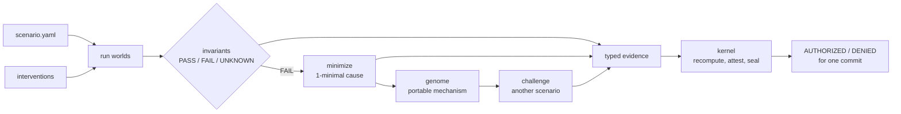

# WORLDLINE

**Run a system in many worlds, isolate the one difference that breaks a guarantee, turn it into a portable failure mechanism, and let nothing deploy on evidence it cannot type.**

A change is normally judged against one world: the test suite's. The failures that matter live in other worlds, such as the one where the correcting report arrived ninety seconds late, or the one where a permission was revoked mid-run. WORLDLINE asks what your system would do if the world were different and which differences actually matter. It also refuses to let an agent certify its own work.

[Get started](get-started/install.md){ .md-button .md-button--primary }
<a class="md-button" href="../">Open the viewer</a>
[Source on GitLab](https://gitlab.com/shafir2/WorldLine){ .md-button }

!!! note "Synthetic by default"
    Every scenario in the repository is synthetic, except the USGS scenario, whose truth stream is real recorded public data (see [Real-data scenarios](guides/real-data.md)). Transfer of failure mechanisms is shown within the shared Event v1 substrate, not across heterogeneous codebases.

## The 60-second tour

### 1. One history, many worlds


A **scenario** is a deterministic world: roles that observe events through their own delivery latencies, and actors that make rule-based decisions from what their role has *received*. WORLDLINE runs it once (the root world), then branches it under **interventions** such as delaying, dropping, or corrupting a delivery. Each branch is checked against three-valued **invariants**. See [Worlds](concepts/worlds.md) and [Interventions](concepts/interventions.md).

### 2. The world that broke


In the `port_alert` scenario, the duty officer decides at 1500 s whether to escalate. In the root world, a correction arrives in time and the decision is "monitor". In one branch, the same correction arrives late, and the officer escalates on stale information. The invariant `decision.consistent_with_truth` reports FAIL and names the events the officer had not yet received. See [Invariants](concepts/invariants.md).

### 3. One cause, as a mechanism


Delta debugging reduces the failing schedule to a **1-minimal** cause, here a single delayed correction, and then checks minimality independently. WORLDLINE abstracts that cause into a **failure genome**, "delay the last correcting report a deciding role received before its decision", and challenges a second scenario with it. The genome reproduces on the convoy scenario and not on its deliberately immune control. See [Minimization](concepts/minimization.md) and [Failure genome](concepts/genome.md).

### 4. Nothing ships on untyped evidence


Every claim is typed: PROVED_WITHIN_MODEL, EMPIRICALLY_VALIDATED, ATTESTED, FAILED, or UNKNOWN. The **kernel** recomputes what agents reported, attests only what matches, and seals the chain with Ed25519. It authorizes a release for one exact commit only when the policy is met. A one-byte edit to the bundle is a DENIED with a named finding. See [Evidence kinds](concepts/evidence-kinds.md) and [The kernel](concepts/kernel.md).

### 5. Every branch, inspectable


The viewer shows both exploration strategies as branch trees, the per-role timelines with information lag, the causal diff against the root, and the evidence chain. It is static and published next to these docs.

## The whole chain in one command

```bash
uv run worldline demo --out experiments/out --budget 150 --seed 42
```

The demo explores, minimizes, extracts the genome, challenges the second scenario, writes the agent evidence, runs the kernel, and authorizes. It ends with `AUTHORIZED`, then shows `DENIED` for a deliberately tampered bundle. [Run it yourself](get-started/first-run.md).

## How it fits together



## Where to go next

| If you want to | Read |
|---|---|
| Install and run it | [Install](get-started/install.md), [First run](get-started/first-run.md) |
| Understand a result | [Read the output](get-started/read-the-output.md) |
| Learn the model | [Concepts](concepts/index.md) |
| Write your own world | [Author a scenario](guides/authoring.md), [Scenario schema](reference/scenario-schema.md) |
| Gate releases on GitLab | [GitLab workflow](guides/gitlab-workflow.md), [Releases and verification](guides/releases.md) |
| Check a release from outside | [Verifier API](reference/verifier-api.md) |
| Know what has been claimed and measured | [Research](research/index.md) |
