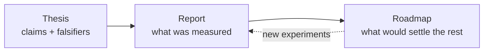

# Research

These pages are the **technical background** behind WORLDLINE. They are included from the repository as written, and they are the record of what is claimed, what was measured, and what remains open. They explain *why*, not *how to use*. For usage, start with [Get started](../get-started/install.md).

| Document | What it is |
|---|---|
| [Thesis and prior art](thesis.md) | The problem, the four contributions stated so that they can be falsified, prior art and what is reused versus new, and the defining experiment. |
| [Technical report](report.md) | Measurements only: guided versus random exploration, minimization, genome transfer with a negative control, the evidence kernel, the agent loop on GitLab, releases and deployment, and the limitations. |
| [Roadmap](roadmap.md) | The research program: each item names its question, the experiment that would settle it, and what would count as failure. |

!!! warning "Claim ceiling"
    The headline results are EMPIRICALLY_VALIDATED on synthetic scenarios (plus one real-data truth stream) on one machine. Nothing is PROVED_WITHIN_MODEL. Transfer is within the shared Event v1 substrate, not across heterogeneous codebases.
