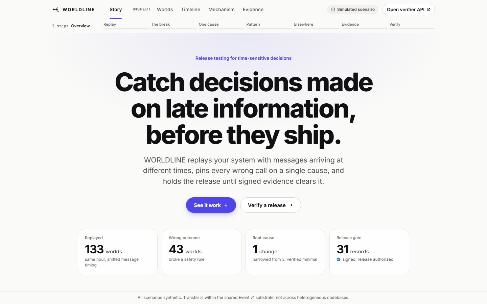

# WORLDLINE viewer (`ui/`)

Static Vite + React + TypeScript viewer over the JSON that the WORLDLINE pipeline writes to `experiments/out/`. No backend, no UI kit: hand-written CSS, plain SVG, light/dark via `prefers-color-scheme`. Built with `base: './'` so it deploys unchanged under a GitLab Pages subpath.

> Every scenario is **simulated**. A "Simulated scenario" badge in the top bar explains the split on hover or keyboard focus: the world itself (scenario, actors, messages, timing faults) is synthetic; every count, timing, verdict and signature shown about it is measured by the pipeline and can be re-checked. A persistent footer repeats the scope: "All scenarios synthetic. Transfer is within the shared Event v1 substrate, not across heterogeneous codebases."



## Story (default route `#/`)

A hero states the run in four numbers (worlds replayed, worlds with a wrong outcome, the size of the root cause, records behind the release gate). Below it, seven full-width beats each carry a headline, a short lede and one visual. Headlines and the short labels of the progress bar come from `STORY_BEATS` in `src/config.ts`; every number comes from the data files.

| # | Progress label | Headline | What it shows |
| --- | --- | --- | --- |
| 1 | Replay | One hour, replayed *N* ways | Every exploration run as a half-circle fan (failing worlds as red diamonds), a strategy toggle, and guided vs random as two large numbers and a per-100 bar pair. |
| 2 | The break | The replay that broke | The minimal counterexample in three lanes (what actually happened, the deciding role, one other role). The held-back correction slides past the decision marker; a play button and scrubber show what the decider knew at each moment. |
| 3 | One cause | Narrowed to one cause | The ddmin result as "*N* changes tried, 1 explains it". Removed changes are dashed and struck through, with a "Removed" label; the kept one is outlined in red. Checks for `one_minimal_verified` and `self_explaining`. |
| 4 | Pattern | A pattern, not a one-off bug | The genome as a sentence, a kind → role → decision diagram, and the preconditions as checklist chips. |
| 5 | Elsewhere | Tested on a different system | The challenge: the look-alike scenario (reproduced) and the immune twin (preconditions met, not reproduced) as two cards. |
| 6 | Evidence | The release waits for signed evidence | The bundle as records grouped by producer (agent, kernel), certainty shown by shape and colour, and an AUTHORIZED / DENIED toggle that names the edited record. |
| 7 | Verify | Verify a release yourself | Two steps against the live verifier. **1 Choose a bundle** (the shipped `bundle.json`, the edited copy `bundle_tampered.json`, or your own file) and press **Verify bundle** (`POST /api/verify`). **2 Check the release gate** (`POST /api/authorize` with the `release` policy). A "Run it from a terminal" panel gives the matching `curl` commands. Endpoints are defined once, in `src/config.ts`. |

A seven-segment progress bar under the top bar tracks the beat on screen; each segment jumps to its beat. `#/story/<n>` deep-links to beat *n*. Raw sha256 strings never appear in the default view: identifiers show as 7-character short ids with a copy button, and the full value is in the tooltip and on the clipboard (`src/components/ShortId.tsx`).

## Inspect views

Each Inspect view opens with the question it answers and a one-paragraph answer computed from the data, then a context bar, then the detail.

| View | Question | What it shows | Screenshot |
| --- | --- | --- | --- |
| **Worlds** `#/worlds` | Which worlds broke, and why? | A strategy switch over every run in `exploration.json` (guided, random, windowed when present, or all merged). Filter chips for what broke and the change type, plus "Include worlds that held". A sortable table with one row per distinct schedule (arrow keys move, Enter opens the timeline) and a side panel for the selected world: its changes, verdicts and technical details. Collapsed below: the branch tree (parent → child) and a per-strategy comparison table (`n_nodes`, `n_failing`, `failing_rate_per_100`, `first_decision_fail_index`, `wall_ms` from `exploration.comparison`, definitions on hover). | `docs/screens/worlds.png` |
| **Timeline** `#/timeline` | What did each role know, and when? | A world picker (baseline, minimal counterexample, challenge counterexample, failing worlds grouped by strategy). One lane per role: each event sits at `event_time_ns` with a line to `received_time_ns`, decisions are diamonds, FAIL-witness events are ringed. A known-at scrubber with previous/next-arrival steps dims what has not arrived yet; event-kind toggles filter the lanes; **Compare with the baseline** overlays the root's arrival times and lists every difference (off for the challenge trace, which is a different scenario). Click an event to pin it. | `docs/screens/timeline-inspect.png` |
| **Mechanism** `#/mechanism` | What is the single cause, and does it transfer? | Three steps. **1 Minimize** (ddmin): changes tried vs kept, the reduction steps, and the `one_minimal_verified` / `self_explaining` checks. **2 Abstract** (`genome.extract`): the mechanism sentence, its evidence kind, and the preconditions with their machine names. **3 Challenge** (`genome.challenge`): the look-alike scenario and the immune twin, each with its preconditions, the planted change and the verdicts. | `docs/screens/mechanism.png` |
| **Evidence** `#/evidence` | Why was this release allowed? | A switch between the real bundle (`authorization.json`) and the edited copy (`authorization_denied.json`). The decision banner and its reasons, what the policy requires and which records satisfy it, and the evidence grouped by claim: each record has a certainty badge (shape **and** colour), a producer tag and its raw JSON, and the edited record is flagged. Below, **Does it hold beyond one seed?** from `benchmark.json`: exploration aggregates for every strategy (guided, random, windowed) and ddmin aggregates (mean / median over seeds), definitions on hover and in full, and the claim ceiling. | `docs/screens/evidence-inspect.png` |

Other screenshots in `docs/screens/`: `timeline.png` (Story beat 2), `evidence.png` (Story beat 6), `verify.png` (Story beat 7) and `mobile.png` (390 px wide).

## Run

Prerequisites: Node 20+ (tested on Node 24).

```bash
cd ui
npm ci
npm run dev          # http://localhost:5173, serves ./fixtures as ./data via a Vite middleware
npm run build        # copy-data + typecheck + vite build -> ui/dist
npm run preview      # serve ui/dist locally (http://localhost:4173)
```

Other scripts:

```bash
npm run copy-data    # copies ../experiments/out -> public/data if it has JSON, else ./fixtures
npm run typecheck
```

## Tests

A Playwright suite in `e2e/` (42 tests: routes, key numbers, keyboard, 390 px layout, dark mode, axe in light and dark, JS and first-paint budgets) runs against `vite preview` serving the **built** bundle. Coverage, budgets and how to read failures: [`docs/UI_QA.md`](../docs/UI_QA.md).

```bash
npx playwright install chromium     # once per machine
npm run build
npm run test:e2e                    # serves dist/ on http://localhost:4317 and runs the suite
npx playwright show-report e2e/.output/report

# Isolated build, safe when someone else rebuilds dist/ at the same time:
node e2e/build-snapshot.mjs && E2E_DIST=e2e/.output/dist npm run test:e2e
```

`npm run test:e2e:ci` is what CI runs (`--forbid-only`).

## Screenshots

`docs/screens/*.png` are taken from `npm run preview` with headless Edge at 1440x900, for example:

```powershell
& "C:\Program Files (x86)\Microsoft\Edge\Application\msedge.exe" --headless=new --disable-gpu --hide-scrollbars --window-size=1440,900 --virtual-time-budget=10000 --screenshot=..\docs\screens\worlds.png "http://localhost:4173/#/worlds"
```

## How data is loaded

The app fetches **relative** URLs: `new URL("data/<file>", document.baseURI)`. File names are fixed by the pipeline (see the contract below), so `src/data.ts` hardcodes them: it reads `index.json`, then `exploration.json`, `minimal_schedule.json`, `genome.json`, `challenge.json`, `bundle.json`, `authorization.json` in parallel, plus `authorization_denied.json` and `benchmark.json` when present. Traces and verdict files are fetched lazily when a trace is opened in Timeline, resolved through the registry built from `exploration.trace_files`, `minimal_schedule.trace_files` and `challenge.primary.trace_file`.

- **Dev**: `vite.config.ts` registers a small middleware that serves `ui/fixtures/**` at `./data/**`. No copying needed.
- **Build**: `npm run build` runs `copy-data` first, which fills `public/data/` (gitignored). Vite copies `public/` verbatim, so `dist/data/**` ships next to the bundle.
- **CI / Pages**: run the pipeline so `experiments/out/*.json` exists, then `npm run build`; `copy-data` prefers the real output over the fixtures. Publish `ui/dist`.

## Data contract

The real files under `experiments/out/` are authoritative; `src/types.ts` mirrors them and the UI adapts, never the pipeline. Written by `worldline explore | minimize | genome extract | genome challenge | bundle | authorize | benchmark | report`.

| File | Shape (top level) |
| --- | --- |
| `index.json` | Manifest from `worldline report`: `generated_at`, `code_commit`, `environment`, `claim_ceiling`, `claims[] {id, claim, kind}`, `digests {root_trace_digest, minimal_trace_digest, minimal_schedule_hash, genome_id}`, `files {"<path>": {bytes, sha256}}`. It is **not** a logical file map. |
| `exploration.json` | `scenario_id`, `seed`, `budget`, `schedule_size`, `strategies`, `root_digest`, `runs {strategy: ExplorationRun}` (`guided`, `random`, and `windowed` when the run includes it), `comparison {strategy: {n_nodes, n_failing, failing_rate_per_100, first_decision_fail_index (null if none), wall_ms}}`, `trace_files {branch_id: {trace, verdicts, strategy?, failing_invariants?}}`. An `ExplorationRun` has `nodes[] {branch_id, parent, schedule, trace_digest, verdicts[], failing_invariants[], cost_ns}`, `failing[]`, `n_nodes`, `n_failing`, `n_rejected`, `rejected[]`, `wall_ns`. All runs share `root`; traces are exported for root and failing branches only. |
| `minimal_schedule.json` | `target_invariant`, `strategy`, `branch_id` (the failing branch ddmin started from), `original[]`, `minimal[]`, `minimal_branch_id`, `minimal_schedule_hash`, `trace_digest`, `oracle_calls`, `cache_hits`, `one_minimal_verified`, `self_explaining`, `steps[] {size, fails}`, `witness[]`, `explanation`, `selection_rule`, `candidates_considered[]`, `causal_diff {a, b, differs, truth_identical, decisions[], views{role: {received_time_moved[], ...}}}`, `trace_files {minimal, minimal_verdicts}`. |
| `genome.json` | `id`, `violated_invariant`, `mechanism[] {op, selector{kind, role, position, relation}, params}`, `mechanism_sentence`, `preconditions[]`, `witness_shape`, `origin {scenario_id, seed, branch_id, trace_digest, minimal_schedule_hash, invariant_version, code_commit, witness[]}`, `evidence_kind`, `claim_ceiling`. Selectors are abstract: no concrete event ids. |
| `challenge.json` | `genome_id`, `success`, `seed_note`, `claim_ceiling`, `primary: ChallengeResult`, `controls[]: ChallengeResult`. A `ChallengeResult` has `scenario_id`, `target_rule`, `preconditions_met`, `preconditions_report {name: bool}`, `instantiated_schedule[]`, `verdicts[]`, `reproduced`, `counterexample_digest`, `explanation`, and `trace_file` when a counterexample trace was written (`traces/challenge_<scenario>.json`). For a control, "preconditions met, not reproduced" is the success case. |
| `bundle.json` | `format: "worldline.bundle.v1"`, `records[] EvidenceRecord {id, kind, claim, subject, procedure, inputs_hash, result, assumptions[], derived_at, producer}`, `links[] {hash, prev_hash}` (one per record, same index), `checkpoint {root, first_index, last_index, sealed_at, signer_key_id, signature}`. `bundle_tampered.json` is the same bundle with one record edited. |
| `authorization.json` / `authorization_denied.json` | `decision: AUTHORIZED \| DENIED`, `policy` (name), `artifact_digest`, `bundle_file`, `evaluated_at`, `reasons[]`, `satisfied[] {claim_pattern, record_id, kind, producer, ...}`, `missing[]`, `stale[]`, `downgraded[]`. The denied file is the same policy evaluated on `bundle_tampered.json`; its reason names the edited record index (`integrity:record_edited@<i>`). |
| `benchmark.json` | `scenario_id`, `seeds[]`, `budget`, `schedule_size`, `target_invariant`, `claim_ceiling`, `definitions {metric: text}`, `environment`, `exploration {rows[], aggregate {strategy: {metric: {mean, median, n, n_null}, coverage_equal_all?, equivalence_violations_total?}}}` (strategies `guided`, `random`, `windowed`), `parallel?`, `minimization {cases[], skipped[], aggregate {metric: {...}, one_minimal_verified_all}}`. |
| `traces/*.json` | `Trace`: `scenario_id`, `seed`, `branch_id`, `fault_schedule_hash`, `truth {events[], digest}`, `views {role: {events[], digest}}`, `decisions[]`, `clock_end`, `scenario` (embedded spec: `roles[] {id, delivery, visibility}`, `actors[] {id, role, decision_rules[]}`, `invariants[]`, `clock`), `digest`. The fault schedule itself is **not** in the trace; the viewer takes it from the branch node, `minimal_schedule.minimal` or `challenge.*.instantiated_schedule`. File names: `traces/root.json`, `traces/root__sha256-<hash>.json` (per `trace_files`), `traces/minimal.json`, `traces/challenge_<scenario>.json`. |
| `verdicts/*.json` | `VerdictRecord[]` for the trace of the same name: `invariant_id`, `invariant_version`, `result`, `witness[]`, `explanation`, `missing_data[]`, `derived_at_ns`, `trace_digest`. |

Routing is by hash: `#/<view>/<trace key>` where the key is a `branch_id` or `challenge:<scenario_id>` for a challenge counterexample.

## Fixtures

`ui/fixtures/` is a snapshot of a real `experiments/out/` run (`port_alert`, seed 42; marked `"synthetic": true` in its `index.json`), kept so `npm run dev` and `npm run build` work before the pipeline has run. To keep it small it ships only the traces the views link to (root, minimal, challenge counterexample and the ddmin candidates); opening any other branch in Timeline shows a "file missing" notice. Refresh it by copying `experiments/out/` over it.

## Project structure

```
ui/
├─ fixtures/              snapshot of experiments/out (index.json, exploration.json, traces/, verdicts/, ...)
├─ scripts/
│  └─ copy-data.mjs       experiments/out or fixtures -> public/data
├─ src/
│  ├─ App.tsx             top nav (Story · Inspect), "Simulated scenario" badge, story progress, skip link, hash routing (#/view/key), footer
│  ├─ config.ts           verifier URL, release link, footer text, STORY_BEATS (single source)
│  ├─ data.ts             relative fetch, useData, trace registry, useTrace
│  ├─ diff.ts             causal_diff computed client-side (root vs branch)
│  ├─ format.ts           time/hash/intervention/strategy formatting
│  ├─ types.ts            shapes of the real pipeline output
│  ├─ components/         Badges, Inspect (ViewIntro, ContextBar, Seg, Chip, Disclosure, Tip), Schedule, ShortId
│  └─ views/              Landing (hero), Story (default), Worlds, Timeline, Mechanism, Evidence (+ Benchmark card)
├─ e2e/                  Playwright suite (docs/UI_QA.md); output in e2e/.output (gitignored)
├─ index.html · vite.config.ts · playwright.config.ts · tsconfig.json · package.json
```
